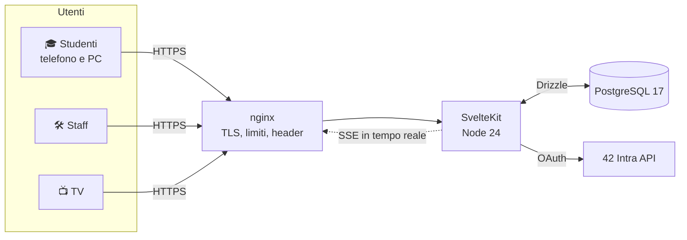

<div align="center">

<picture>
  <source media="(prefers-color-scheme: dark)" srcset=".github/assets/logo-dark.svg">
  
</picture>

### Il gestionale dei turni Baywatchers di 42 Firenze 🏊

Calendario, iscrizioni, presenze e display TV, in tempo reale, su telefono e su desktop.

[](https://github.com/SamirAbdeslam/gestionale-baywatchers-42Firenze/actions/workflows/ci.yml)
[](https://github.com/SamirAbdeslam/gestionale-baywatchers-42Firenze/tags)
[](LICENSE)
[](messages/)


[Funzioni](#-funzioni) · [Architettura](#-architettura) · [Avvio rapido](#-avvio-rapido) ·
[Configurazione](#-configurazione) · [Test](#-test) · [Versioni](#-versioni)

</div>

## ✨ Funzioni

<table>
<tr>
<td width="33%" valign="top">

### 🎓 Studenti

- 📅 Calendario della settimana attiva, sempre aggiornato
- 🎟️ Iscrizione con animazione del biglietto
- ⏭️ «Il tuo prossimo turno» e «N di M turni»
- 📲 Download `.ics` di ogni turno
- 👤 Profilo con turni, ore e ₳ Altarian
- 🎁 Riepilogo stile _Wrapped_ con badge
- ⏳ Countdown prima dell'inizio della piscina
- 📷 Iscrizione alla piscina con QR

</td>
<td width="33%" valign="top">

### 🛠️ Staff

- 🗓️ Eventi, settimane e attivazione
- ✅ Presenze e whitelist
- 🧩 Template con builder e import CSV
- 🔁 Duplica evento, settimana come template
- 📊 Partecipanti ed export CSV
- 🏁 Ciclo di vita della piscina: chiusura, archivio, pulizia verificata
- 🗄️ Archivio storico con grafici
- 📋 Log di tutte le operazioni

</td>
<td width="33%" valign="top">

### 📺 Display e sistema

- 🖥️ Schermo TV con evento in corso e prossimo
- ⚡ Aggiornamenti in tempo reale (SSE)
- 🌍 Italiano, inglese, francese
- 🌗 Tema chiaro e scuro
- 📱 Pensato prima per il telefono
- ♿ Funziona anche senza JavaScript
- 🔐 Login 42, solo campus Firenze
- 🛡️ Audit di sicurezza completato

</td>
</tr>
</table>

## 🧭 Architettura



|                 |                                                                           |
| --------------- | ------------------------------------------------------------------------- |
| 🧱 **Frontend** | SvelteKit 3, Svelte 5 (runes), CSS con design tokens, Paraglide (i18n)    |
| ⚙️ **Backend**  | Azioni e load di SvelteKit, Zod per la validazione, bus SSE in memoria    |
| 🗃️ **Dati**     | PostgreSQL 17, Drizzle ORM e migrazioni in `drizzle/`                     |
| 🔐 **Accesso**  | OAuth 42 (campus Firenze), sessioni salvate come hash, guard per le rotte |
| 🚢 **Deploy**   | Docker Compose: app, Postgres e nginx con HTTPS su 8080/8443              |

## 🚀 Avvio rapido

**Requisiti**

- 🟢 **Node.js 24** (`.nvmrc`)
- 📦 **pnpm 10** tramite Corepack: `corepack enable && corepack install`
- 🐳 **Docker** con Compose
- 🔏 **OpenSSL** per il certificato locale

```sh
cp .env.example .env                             # poi AUTH_DEV_LOGIN=true per lo sviluppo
pnpm install
docker compose -f compose.dev.yaml up -d --wait  # Postgres su 127.0.0.1:5432
pnpm db:migrate
pnpm db:seed                                     # dati fittizi: dev_admin, dev_user, dev_outsider
pnpm dev                                         # con ORIGIN=http://localhost:5173
```

Con `AUTH_DEV_LOGIN=true` si entra da `/auth/dev` senza passare da 42. 🔑

## 🔧 Configurazione

Copiare `.env.example` in `.env`: ogni variabile ha un commento. L'app valida tutto all'avvio e non parte se manca
un valore obbligatorio. `.env` resta fuori da Git.

| Variabile                          | A cosa serve                                                                                                          |
| ---------------------------------- | --------------------------------------------------------------------------------------------------------------------- |
| `ORIGIN`                           | Indirizzo pubblico. Viene incorporato nella build (`kit.paths.origin`): quando cambia, ricostruire.                   |
| `FT_CLIENT_ID`, `FT_CLIENT_SECRET` | App OAuth 42, con redirect URI `<ORIGIN>/auth/callback`.                                                              |
| `AUTH_DEV_LOGIN`                   | `false` di default. `true` solo in sviluppo, con `ORIGIN` su `localhost` o `127.0.0.1`: abilita `/auth/dev`.          |
| `DISPLAY_TOKEN`                    | Accesso della TV (`/display?token=…`). Obbligatorio fuori da localhost, almeno 32 caratteri (`openssl rand -hex 32`). |
| `DISPLAY_REDIRECT_URL`             | Pagina facoltativa verso cui la TV torna dopo `DISPLAY_REDIRECT_SECONDS`.                                             |
| `DATABASE_URL`, `POSTGRES_*`       | Connessione e credenziali di Postgres.                                                                                |

## 🧪 Test

```sh
pnpm ci:local
```

<table>
<tr>
<td>🐘 Postgres di sviluppo</td><td>→</td><td>🗃️ migrazioni su <code>baywatchers_test</code></td><td>→</td>
<td>🧹 lint e check</td><td>→</td><td>🧪 unit e integration</td><td>→</td><td>🏗️ seed e build</td><td>→</td>
<td>🎭 e2e Playwright</td>
</tr>
</table>

Gli e2e girano su Chromium desktop e mobile e su WebKit, con e senza JavaScript. La prima volta servono i browser:
`pnpm exec playwright install chromium webkit`.

| Comando                 | Cosa esegue                                |
| ----------------------- | ------------------------------------------ |
| `pnpm test:unit`        | test unitari                               |
| `pnpm test:integration` | test sul database (`DATABASE_URL` di test) |
| `pnpm test:e2e`         | test nel browser                           |

La [CI su GitHub](.github/workflows/ci.yml) esegue gli stessi controlli a ogni push.

<details>
<summary>🔒 <b>Stack completo con nginx e HTTPS</b></summary>
<br>

In `.env` impostare `DATABASE_URL` con host `db` e `ORIGIN=https://localhost:8443`. Prima del primo avvio generare
il certificato locale (365 giorni). Il comando protegge la chiave e non sovrascrive certificati esistenti:

```sh
mkdir -m 700 -p nginx/certs
(
  umask 077
  test ! -e nginx/certs/localhost.key && test ! -e nginx/certs/localhost.crt &&
    openssl req -x509 -newkey rsa:2048 -noenc -sha256 -days 365 \
      -subj '/CN=localhost' \
      -addext 'subjectAltName=DNS:localhost,IP:127.0.0.1,IP:::1' \
      -keyout nginx/certs/localhost.key -out nginx/certs/localhost.crt
)
docker compose up -d --build
```

- 🌐 `http://localhost:8080` reindirizza a `https://localhost:8443`. Le porte 80 e 443 non vengono usate.
- 🔐 Database e app non espongono porte. Le migrazioni si applicano all'avvio dell'app.
- ⚠️ Il browser avvisa perché il certificato è autofirmato. Controllo da terminale:
  `curl --cacert nginx/certs/localhost.crt https://localhost:8443/healthz`.
- 📁 I certificati restano in `nginx/certs/`, fuori da Git e dall'immagine Docker.
- 🏗️ Build senza Compose: `docker build --build-arg ORIGIN=https://localhost:8443 .`.

- ⛔ **Non usare `docker compose down -v`**: cancella il volume del database.

</details>

<details>
<summary>🌍 <b>Lingue</b></summary>
<br>

Le stringhe dell'interfaccia sono in `messages/it.json`, `messages/en.json` e `messages/fr.json`, con le stesse
chiavi (un test lo verifica). La lingua si sceglie dal selettore nell'header e resta salvata in un cookie. Titoli
degli eventi, CSV e descrizioni dei log restano in italiano.

</details>

<details>
<summary>📦 <b>Import dal vecchio database</b></summary>
<br>

`pnpm legacy:import -- --sqlite <calendar.db> [--dry-run]` e `pnpm legacy:verify -- --sqlite <calendar.db>` sono
verificati in CI su un database fittizio (`pnpm legacy:fake-db`). Non fanno parte dell'avvio: la v2 parte con un
database vuoto. Il codice Flask originale resta nella storia Git.

</details>

## 🏷️ Versioni

| Versione                                                                                                                                       | Cosa porta                                                                              |
| ---------------------------------------------------------------------------------------------------------------------------------------------- | --------------------------------------------------------------------------------------- |
| [](https://github.com/SamirAbdeslam/gestionale-baywatchers-42Firenze/releases/tag/v2.4.1) | ⚙️ CI solo per main, e2e in 3 job paralleli                                             |
| [](https://github.com/SamirAbdeslam/gestionale-baywatchers-42Firenze/releases/tag/v2.4.0) | 🧑‍🚒 Staff presente, controllo dei login, badge meme, tocco nel riepilogo, log in inglese |
| [](https://github.com/SamirAbdeslam/gestionale-baywatchers-42Firenze/releases/tag/v2.3.2) | 📦 Dipendenze: esbuild aggiornato per drizzle-kit                                       |
| [](https://github.com/SamirAbdeslam/gestionale-baywatchers-42Firenze/releases/tag/v2.3.1) | 🛡️ Correzioni dell'audit finale e di sicurezza                                          |
| [](https://github.com/SamirAbdeslam/gestionale-baywatchers-42Firenze/releases/tag/v2.3.0) | 🏁 Ciclo di vita della piscina, archivio completo, riepilogo finale, QR                 |
| [](https://github.com/SamirAbdeslam/gestionale-baywatchers-42Firenze/releases/tag/v2.2.0) | 🗄️ Archivio delle piscine, statistiche, riepilogo animato                               |
| [](https://github.com/SamirAbdeslam/gestionale-baywatchers-42Firenze/releases/tag/v2.1.0) | ⏭️ Prossimo turno, duplica evento, chiusura piscina, display in corso                   |
| [](https://github.com/SamirAbdeslam/gestionale-baywatchers-42Firenze/releases/tag/v2.0.0) | 🚀 Riscrittura completa in SvelteKit                                                    |

Ogni tag contiene la descrizione completa delle modifiche: `git show v2.4.1`.

---

<div align="center">
<sub>Fatto con 🧡 e Claudia 🤖 per i Baywatchers di <b>42 Firenze</b> · Licenza <a href="LICENSE">GPL-3.0</a></sub>
</div>
